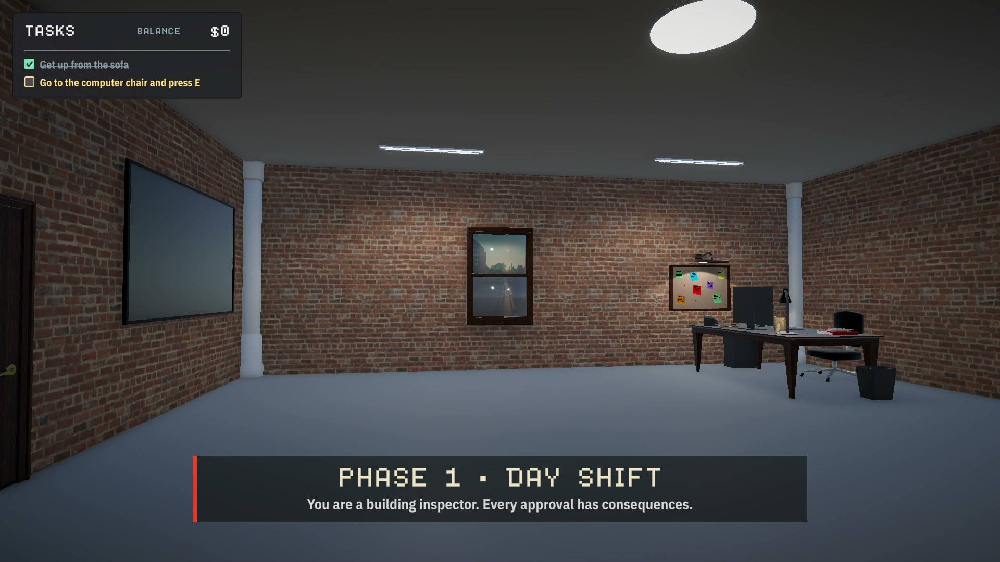
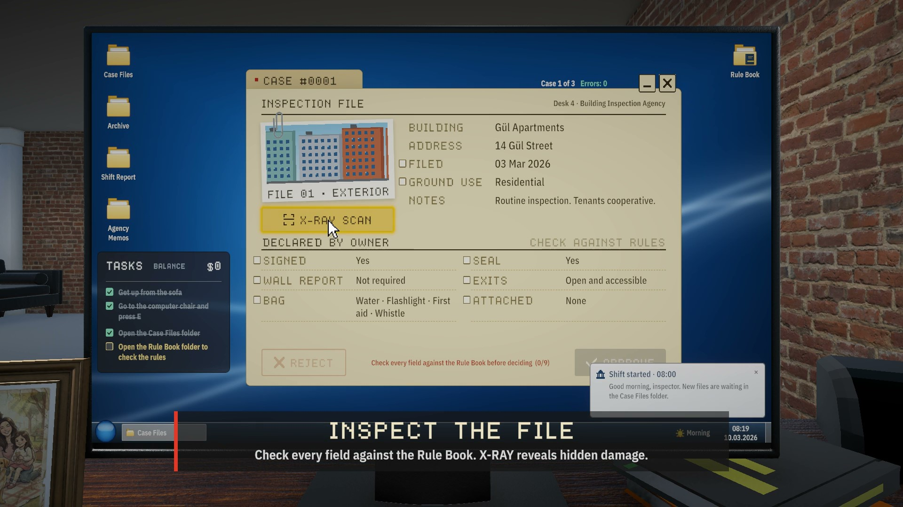
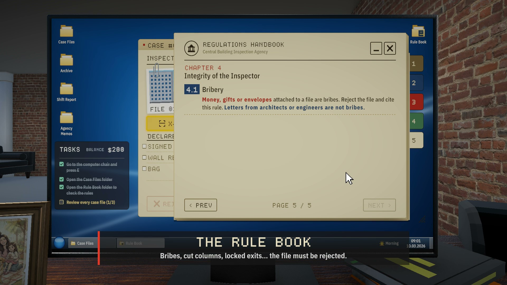
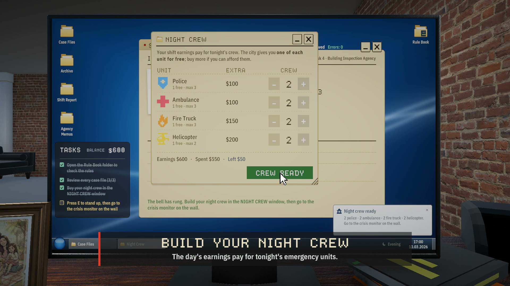
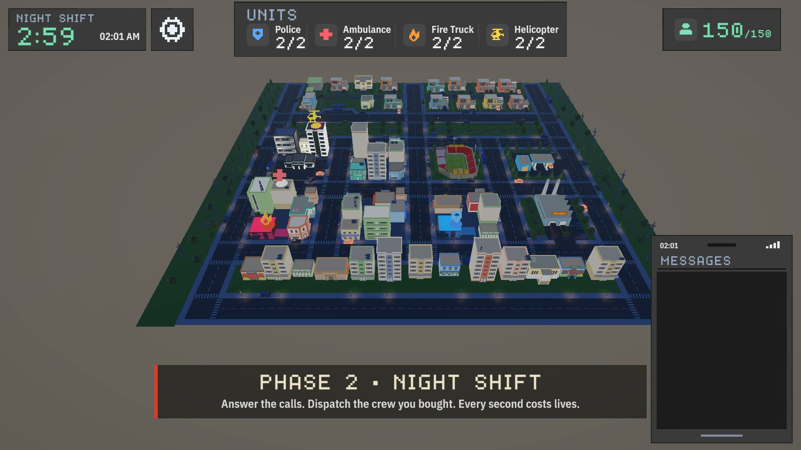
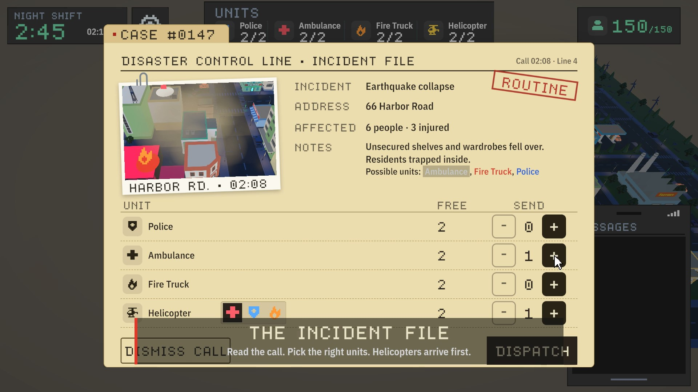
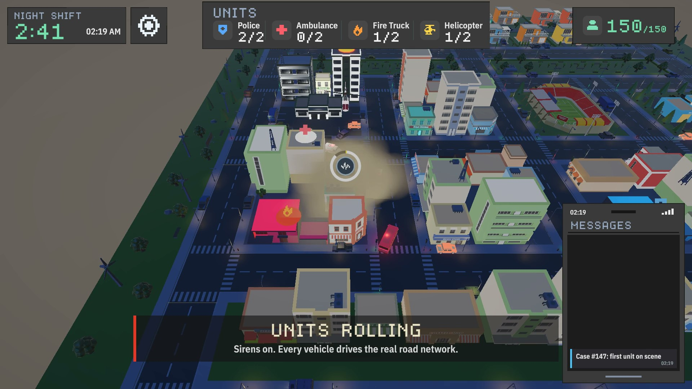

# 🏢 SIGN (Disaster Control Line)

## 📌 Oyun Hakkında
**SIGN**, iki ana fazdan oluşan, bürokrasi simülasyonu ile kriz ve kaynak yönetimini birleştiren gerilim dolu bir oyundur. 

Gündüz vardiyasında masa başında binaların denetim dosyalarını inceleyip **APPROVE** (Onay) veya **REJECT** (Red) kararları verirken; gece vardiyasında ise "Damage Control Line" kriz masasına geçerek şehirde patlak veren afetlere karşı kısıtlı acil durum birimlerini yönetirler. Gündüz alınan bürokratik kararların ve rüşvet/ihmal tercihlerinin sonuçları, gece şehirdeki yıkım ve can kaybı miktarı olarak doğrudan oyuncunun karşısına çıkar.

---

## 🎬 Hikaye ve Motivasyon (Trailer & Arka Plan)
Oyunda yönettiğimiz ana karakter **Deniz** (Yapı Denetim ve Kriz Masası Memuru), geçmişte yaşanan yıkıcı bir depremde ailesini kaybetmiştir. Başka insanların da aynı acıyı, çaresizliği ve hüznü yaşamaması için kendisini afet yönetimi ve yapı denetiminde kusursuz bir çalışan olmaya adamıştır. 

Deniz'in masasında duran çerçeveli aile fotoğrafı, alınan her bürokratik kararın arkasındaki vicdani ve duygusal ağırlığı oyuncuya sürekli hatırlatır.

---

## 🎮 Kontroller

### 🔹 Faz 1 – Ofis ve Denetim Masası
| Tuş / Girdi | İşlev |
| :--- | :--- |
| **W, A, S, D** | Karakteri hareket ettir / Yürü |
| **Fare** | Etrafa bak |
| **E** | Sandalyeye otur / kalk, mesai bitince kapıdan gece vardiyasına geç |
| **Sol Tık** | Bilgisayar arayüzü etkileşimleri (klasörler, butonlar, kutucuklar) |
| **Çift Tık** | Masaüstünde klasör aç |
| **R** | Kural kitabını aç / kapat |
| **ESC** | Bilgisayardan kalk, ayarlar formunu kapat |

### 🔹 Faz 2 – Taktiksel Kriz Haritası
| Tuş / Girdi | İşlev |
| :--- | :--- |
| **W, A, S, D / Yön Tuşları** | Taktiksel haritada kamerayı kaydırma (pan) |
| **Fare Tekerleği** | Haritaya yaklaşma / uzaklaşma (zoom) |
| **Sol Tık** | Haritadaki binalara tıklama, afet çağrısı detay panelini açma |
| **Ekip Butonları (UI)** | İtfaiye, Ambulans, Polis veya Kurtarma Helikopteri sevk etme |
| **Boşluk / Kapat Butonu** | Açık olan afet bildirim kartını kapatma |
| **ACCEPT / DECLINE** | Sol alttaki çağrıyı kabul etme (3 sn dinlenir, haritada olay rozeti çıkar) / reddetme (5 sivil kaybı) |
| **Olay Rozetine Sol Tık** | Haritadaki olay rozetine tıklayarak Kaza Dosyasını açma |
| **Kaza Dosyası `[-]` / `[+]`** | Gönderilecek birim sayısını seçme (Polis, Ambulans, İtfaiye, Helikopter) |
| **DISPATCH / DISMISS CALL** | Seçili birimleri olay yerine sevk etme / çağrıyı kapatma (yaralılar kaybedilir) |
| **ESC / Dosya Dışına Tık** | Kaza Dosyasını cezasız kapatma |
| **Helikopter `[+]` → Rol Bölmesi** | Her helikopter için ambulans / polis / itfaiye logosundan birini seçme (joker birim olarak atama) |
| **Sol Üst Dişli / ESC** | Ayarlar menüsü (ses, müzik, dil, tam ekran); açıkken oyun durur |
| **Sol Üst Sayaç** | Vardiyanın kalan süresi (3:00) ve oyun saati (02:00 → 05:00). Süre bitince karne açılır |

---

## 🔄 Oynanış Akışı (Gameplay Loop)

1. **Ana Menü:** Oyuna `START SHIFT` butonu ile başlanır. Ayarlar menüsünden ses, müzik, dil (EN/TR) ve tam ekran tercihleri ayarlanabilir.
2. **Uyanma:** Oyuncu kanepede uyanır, sol üstteki görev kutusu (`TASKS`) adım adım yapılması gerekenleri gösterir.
3. **Mesai Başlangıcı:** Bilgisayarın başındaki sandalyede `E` tuşuna basıldığında mesai 08:00'de başlar (08:00–17:00 mesaisi gerçek zamanda yaklaşık 2 dakika sürer).
4. **Dosya İnceleme (Faz 1):** BIA OS (Windows 7 temalı masaüstü) üzerinde `Case Files` ve `Rule Book` klasörleri açılır.
   * Her dosyada yer alan 8 alan ve **X-RAY** taraması kural kitabındaki şartlara göre doğrulanır. Bütün kontroller bitmeden karar butonları aktif olmaz.
   * Dosyadaki alan adına tıklamak, kural kitabında doğrudan ilgili sayfayı açar.
   * Karar aşamasında onay ya da ret verilir; ret durumunda çiğnenen tüm kurallar ret formunda işaretlenir.
   * Doğru karar verilirse **+$200**, yanlış karar verilirse **-$100** bütçe etkisi yansır.
5. **Mesai Sonu:** Saat 17:00'de zil çalar, oyuncu sandalyeden kalkıp kapıya yürür ve `E` tuşuna basarak gece vardiyasına geçer.
6. **Gece Vardiyası (Faz 2):** Gece brifingi (daktilo efekti) ile başlar; vardiya 02:00 – 05:00 saatleri arasında sürer (gerçek zamanda yaklaşık 3 dakika).
   * Sol alttan gelen çağrı kabul edilir (3 saniye dinlenir) ya da reddedilir (reddedilirse 5 sivil kaybedilir).
   * Kabul edilen çağrının konumunda haritada bir olay rozeti belirir; rozete tıklandığında Kaza Dosyası açılır.
   * Dosyadan sevk edilecek birimler seçilip onaylanır. Araçlar istasyondan çıkar, olay yerine gidip müdahale eder ve üsse geri döner.
   * Şehir genelinde toplam 150 sivil bulunmaktadır; anlık hayatta kalma oranı üstteki HUD sayacından takip edilebilir.
   * Vardiya sonunda performans karnesi görüntülenir, `PLAY AGAIN` butonu ile yeniden başlanabilir.

---

## 📸 Oyun İçi Görseller ve Oynanış Adımları

### 1. Ana Menü (Main Menu)

Oyunun karşılama ve başlangıç ekranı. Üst bantta şehir genelinden anlık canlı haber geçişleri yer alırken, alt HUD panelinde mevcut açık hatlar, hazırda bekleyen birimler ve şehir nüfusu görüntülenmektedir. Oyuncu **START SHIFT** butonuna basarak vardiyasına başlar.

---

### 2. Phase 1: Yapı Denetim Ofisi (Day Shift)

Gündüz vardiyasında Deniz, tuğla duvarlı, klostrofobik yapı denetim ofisinde masa başına geçer. Ekranın sol üst köşesindeki **TASKS** görev listesi adımları yönlendirirken, bilgisayar masasına oturarak bina inceleme işlemine geçilir.

---

### 3. Dosya İnceleme ve X-Ray Taraması (Inspect The File)

Bilgisayar ekranında gelen bina denetim dosyası detaylıca incelenir. Dosyadaki yazılı beyanlar kontrol edilirken, **X-RAY SCAN** mekanizması sayesinde binanın 3D tel kafes (wireframe) modeli incelenerek gizli kolon çatlakları, temel kaymaları veya taşıyıcı sistem hasarları tespit edilir.

---

### 4. Yönetmelik Kitabı (The Rule Book)

Dosyayı onaylamadan veya reddetmeden önce masadaki **Rule Book** (Kural Kitabı) açılır. Kitapta yer alan genel evrak kuralları, taşıyıcı sistem şartları, acil durum ekipmanı zorunlulukları ve rüşvet/etik kuralları tek tek kontrol edilerek kararlar bu kurallara göre verilir.

---

### 5. Gece Ekibini Kurma (Build Your Night Crew)

Gündüz vardiyasının sonunda, onaylanan ve reddedilen dosyalardan kazanılan bütçe ile gece vardiyasında görev yapacak acil durum ekibi (**Night Crew**) satın alınır. Polis, Ambulans, İtfaiye ve Helikopter birimleri arasında bütçe dengesi kurularak geceye hazırlık yapılır.

---

### 6. Phase 2: Kriz Masası (Night Shift)

Afet gerçekleştiğinde 3D izometrik şehir haritası açılır. Zaman hızla akarken şehir nüfusu (150 resident) takip edilir. Sol üstte zaman ve birim sayaçları, sağ altta ise gelen ihbar mesajları görüntülenir. Her saniye hayati önem taşır.

---

### 7. Olay Dosyası ve Yönlendirme (The Incident File)

Şehrin farklı noktalarından gelen ihbar hatlarına tıklanarak olay dosyası açılır. Olayın türüne (deprem enkazı, yangın, sel vb.) ve yaralı durumuna göre eldeki Polis, Ambulans, İtfaiye ve Helikopter birimleri seçilerek olay yerine **DISPATCH** edilir.

---

### 8. Saha Harekatı ve Müdahale (Units Rolling)

Yönlendirilen acil durum araçları sirenlerini açarak şehrin gerçek yol ağını kullanıp olay yerine intikal eder. Gündüz vardiyasında hatalı/rüşvetle onaylanan binalar Phase 2'de ağır enkazlara dönüşür ve bu durum müdahale süresini kısıtlayarak can kayıplarını artırır.
