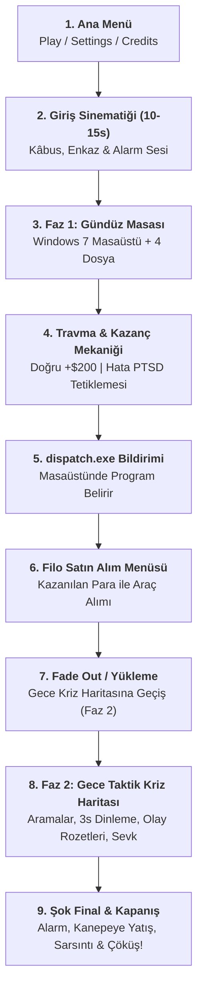

# 🚨 SIFIR SAATİ: DENETİM VE KRİZ (ZERO HOUR)
## Oyun Tasarım ve Tam Akış Dokümanı (GDD & Complete Workflow)
> **Civil Game Jam 2026** · ODTÜ KKK KALTEV · KTMMOB İnşaat Mühendisleri Odası & LootBAG Studios  
> **Tema:** Afet Farkındalığı & Hazırlık (*"Afet, masada atılan vicdansız imzadır."*)

---

## 🎭 1. Karakter, Atmosfer ve Hikâye (Lore & Atmosphere)

### Ana Karakter: Deniz (41, Yapı Denetim Uzmanı)
* **Psikolojik Durum:** Yorgun, uykusuz, derin bir travma ve suçluluk duygusu içinde. İşini artık sadece bir meslek olarak değil, geçmişe karşı bir **kefaret (redemption)** olarak görüyor.
* **Geçmişin İzi:** Yıllar önceki büyük depremde eşi **Ezgi** ve 7 yaşındaki kızı **Ada**’yı enkaz altında kaybetmiştir. O gece enkazdan sağ çıkabilen tek canlı, ailenin köpeğidir. Deniz, ailesini kurtaramamış olmanın ağırlığını her gün masasında taşımaktadır.
* **Masa ve Ofis Ortamı:**
  * Sabit, klostrofobik bir kamera açısı.
  * Masanın sağ köşesinde: **Camı çatlamış çerçeveli bir aile fotoğrafı** (Deniz, Ezgi, kızı Ada ve enkazdan kurtulan köpekleri).
  * Masada soğumuş kahve fincanları, ağrı kesici kutuları, inşaat şartnameleri ve eski bir masa lambası.
  * Karşı duvarda saniye kolu takılarak ilerleyen metalik bir duvar saati.

---

## 🎬 2. Adım Adım Tam Oyun Akışı (Gameplay Workflow)

---

### BÖLÜM 1: Açılış ve Ana Menü (Main Menu)
1. Oyun açıldığında oyuncuyu karanlık, melankolik ve şık bir ana menü karşılar.
2. **Butonlar:**
   * **PLAY (BAŞLA):** Vardiyayı başlatır ve sinematiğe geçer.
   * **SETTINGS (AYARLAR):** Ses, Müzik, Dil ve Tam Ekran ayarları (Yağız'ın tasarladığı modal).
   * **CREDITS (YAPIMCILAR):** Ekip üyeleri ve katkı verenler.

---

### BÖLÜM 2: Giriş Sinematiği (10–15 Saniye - Kâbus ve Uyanış)
1. **Görsel & Ses:** Ekran zifiri karanlık başlar. Boğuk beton sürtünme sesleri, toz bulutu ve Deniz’in kesik kesik nefes alışları duyulur.
2. **Kâbus Sahnesi:** Deniz, elleriyle beton blokları kazımakta, çatlakların arasından kızı Ada'nın sesini duymaktadır: *"Baba... buradayız..."*
3. **Kırılma Anı:** Tam elleri kızının eline değecekken ve onları enkazdan çekip çıkaracakken... **KULAK TIRMALIYICI BİR ALARM SESİ** patlar!
4. **Gerçekliğe Dönüş:** Kamera Deniz’in ofisindeki yıpranmış kanepeye açılır. Deniz kan ter içinde uyanır, masadaki çalar saatin tepesine basarak alarmı kapatır.
5. Bir anlığına sağ taraftaki **camı çatlamış aile fotoğrafına** bakar. Yutkunur. Kanepeden kalkar ve odanın diğer ucundaki bilgisayar masasına oturur.

---

### BÖLÜM 3: Gündüz Masası (Faz 1 — Windows 7 Ekranı)
Deniz bilgisayar ekranına bakar. Nostaljik bir **Windows 7** arayüzü ekrana oturur:

* **Masaüstü Düzeni:**
  * **Sol Taraf:** Bugün incelenmesi zorunlu olan **4 Adet Proje Dosyası** (`Dosya_01.pdf`, `Dosya_02.pdf`, `Dosya_03.pdf`, `Dosya_04.pdf`).
  * **Sağ Üst Köşe:** **KTMMOB İnşaat Mühendisleri Odası Kural Kitapçığı** (Taşıyıcı kolon kuralları, demir donatı standartları, sığınak/tahliye şartları, dere yatağı imar yasakları).
  * **Sağ Alt Köşe:** Görev Çubuğu, dijital saat (`09:00`) ve anlık bakiye göstergesi (`KASA: $0`).

* **Ekonomi ve Ceza Sistemi:**
  | Durum | Kasa Etkisi | Açıklama |
  | :--- | :--- | :--- |
  | **Oturum Başlangıcı** | **$0** | Her gün kasada sıfır dolar ile başlar. |
  | **Doğru Değerlendirme** | **+$200** | Hatalı binayı reddetmek veya sağlam binayı onaylamak. |
  | **1. Hata (İlk İhmal)** | **$0** | İlk hata için sistem uyarı verir, para kesilmez. |
  | **Sonraki Hatalar** | **-$100** | Müteahhit usulsüzlüğü veya yanlış onay nedeniyle ceza kesilir. |

* **Travma & PTSD Tetikleyicileri (Asla Çocuk/Kadın Çığlığı Yok!):**
  * Oyuncu bir usulsüzlüğü fark edemediğinde veya şüpheli bir belgeyi onayladığında:
    1. **Görsel Halüsinasyon:** Ekranda yarım saniyeliğine toz duman içinde çökmüş betonarme kirişler belirir ve kaybolur.
    2. **Kızıl Kararma:** Ekranın kenarlarından merkeze doğru nabız gibi atan koyu kızıl bir gölge (*Vignette*) yayılır.
    3. **Saat Çıldırması:** Odanın duvarındaki saatin akrep ve yelkovanı bir anda manyetik bir fırtınaya tutulmuş gibi delicesine dönmeye başlar.
    4. **İşitsel Travma:** Yüksek frekanslı boğuk bir çınlama (*Tinnitus*) ve Deniz'in hızlanan kalp atış sesi.

---

### BÖLÜM 4: dispatch.exe ve Filo Satın Alım Köprüsü
4 dosyanın da incelenmesi tamamlandığında:

1. **Bildirim ve Alarm:**
   * Bilgisayardan tiz bir uyarı sesi gelir.
   * Ekranın sağ alt köşesinde Windows baloncuk bildirimi belirir:  
     `⚠️ DİKKAT: Şehirde sismik hareketlilik tespit edildi. Masaüstündeki dispatch.exe uygulamasını başlatın!`
2. **dispatch.exe Belirir:**
   * Masaüstünün ortasında kırmızı-mavi acil durum ikonuyla **`dispatch.exe`** belirir.
   * Kullanıcı çift tıklar.
3. **Acil Durum Filosu Satın Alım Menüsü (Procurement Store):**
   * Deniz’in gündüz denetimlerden kazandığı para (**$0 – $800+**) ekranda görünür.
   * Şehrin acil durum depolarından gece için araç kiralaması/satın alımı yapılır:
     * 🚓 **Polis Ekibi (Police Cruiser):** Hızlı intikal, çevre güvenliği, panik kontrolü ($X).
     * 🚑 **Ambulans (Paramedic Unit):** Yaralı sivilleri kurtarma ve hastaneye sevk ($Y).
     * 🚒 **İtfaiye Aracı (Fire Engine):** Yangın söndürme, gaz tahliyesi, enkaz kırma ($Z).
     * 🚁 **Arama-Kurtarma Helikopteri (Helicopter):** Çatı tahliyeleri ve uzak bölgeler ($W).
   * **Stratejik Karar:** Oyuncu parasını bütçesine göre dikkatle paylaştırır. Parası yetmeyen araçtan eksik alır; bu durum gecenin krizinde elini kolunu bağlayacaktır!
4. **Geceye Geçiş:**
   * Oyuncu **[ DISPATCH ]** butonuna basar.
   * Ekran yavaşça kararır (**Fade Out**).
   * Atmosferik bir yükleme/intikal ekranı gelir.
   * Ekran aydınlanır (**Fade In**); saat gece **02:00**'dır ve oyuncu kendini **3D Taktik Kriz Haritası'nın (Faz 2)** başında bulur!

---

### BÖLÜM 5: Gece Kriz Haritası (Faz 2 — Taktik Operasyon)

1. **Sabit Üst HUD:**
   * Sol üst: Satın alınan ve hazır bekleyen araç sayıları: `Police [X]`, `Ambulance [Y]`, `Fire Truck [Z]`, `Helicopter [W]`.
   * Sağ üst: Şehrin hayatta olan sivil nüfusu: `👤 150 / 150`.
2. **Çağrı Gelir (Incoming Call Loop — Her 10-15 Saniyede Bir):**
   * Telefon zili çalar, operatör paneli yanıp söner.
   * **Arama Kabul Edilirse:**
     * 3 saniye boyunca telsiz hışırtısı ve operatör mumble sesleri dinlenir (bilgi toplanır).
     * Çağrı kapanır.
     * 3D Şehir haritasında çağrının geldiği binanın üstünde **Turuncu/Kırmızı Olay Rozeti (Alev/Enkaz Rozeti)** belirir!
     * Operatör rozete/binaya tıkladığında **KAZA DOSYASI (Damage Control Line - Incident File)** açılır.
     * Operatör dosyadaki Polaroid fotoğrafı, adresi ve yaralı sayısını inceler; `[-] [sayı] [+]` butonlarıyla gereken ekipleri seçip **DISPATCH** eder!
     * Araçlar A* NavMesh yolu üzerinden 10.5m konvoy güvenliğiyle binaya intikal eder ve müdahaleye başlar.
   * **Arama Reddedilirse (Dismiss Call):**
     * İhbar yanıtsız kalır; sağ üstteki `150/150` nüfus sayacından siviller kaybedilir!

---

### BÖLÜM 6: Şok Final ve Kapanış (The Inevitable Collapse)

1. **Vardiya Bitişi:**
   * Gece kriz operasyonu tamamlanır, saat **05:00** olur.
   * Bilgisayardan mesai bitiş zili çalar. Ekranda son vicdan raporu belirdikten sonra sistem kapanır.
2. **Kanepeye Dönüş:**
   * Deniz tükenmiş bir halde sandalyesinden kalkar.
   * Ağır adımlarla odadaki eski kanepeye doğru yürür, kendini kanepenin üzerine bırakır.
   * Gözlerini yavaşça kapatır. Derin, sessiz bir nefes alır...
3. **Korkunç Sarsıntı:**
   * Aniden yerin yüzlerce metre altından gelen vahşi, gök gürültüsü benzeri bir uğultu odayı doldurur.
   * Kamera şiddetle titremeye başlar. Duvardaki saat düşer, masadaki çatlak camlı aile fotoğrafı yere çarpıp tuzla buz olur.
4. **Gözlerin Açılışı ve Çöküş:**
   * Deniz dehşet içinde anlık olarak gözlerini açar.
   * Yukarı baktığında tavanın çatladığı ve devasa bir betonarme bloğun tam üstüne doğru hızla çöktüğü görülür!
   * **EKRAN ANİDEN ZİFİRİ KARANLIĞA KESİLİR (Hard Cut to Black)!**
   * Korkunç bir beton çarpma sesi, ardından derin, dondurucu bir ölüm sessizliği...
5. **Kapanış ve Credits:**
   * Karanlığın ortasında yavaşça beyaz harflerle belirir:  
     **THANKS FOR PLAYING**
   * Ardından hüzünlü ve etkileyici bir piyano eşliğinde **Credits (Yapımcılar)** akmaya başlar.

---

## 🏆 4. Murat Oktay ve Jüri Felsefesiyle Doğrudan Bağlantı
* **Gündüz Dökülen Su:** Deniz'in gündüz yorgunlukla veya para kazanma hırsıyla onay verdiği bina, gece çöken Gül Apartmanı'dır!
* **Gece Karıncanın Yaşadığı Afet:** Gündüz onaylanan usulsüzlük gece telsizden anons olarak patlar:  
  *"Merkez! Gündüz onay verilen Gül Apartmanı çöktü! Kolon kesildiği için bina yana yattı, enkaz altında 40 kişi var!"*
* **Şok Finalin Mesajı:** *"Deprem ayrım yapmaz. Başkalarının hayatını ekrandan yönettiğini sanan denetçi de, onay verdiği o çürük şehrin betonları altında kalmaktan kurtulamaz."* Masada atılan her ihmal, eninde sonunda herkesin çatısını başına yıkar!
